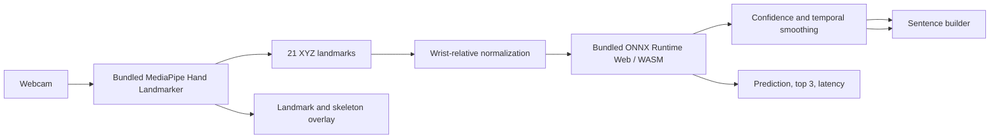

# SignVision

The browser frontend has three source files: `index.html`, `styles.css`, and `script.js`. Camera capture, MediaPipe hand tracking, ONNX inference, and sentence building run in the browser. The MediaPipe task and both WASM runtimes are bundled locally under `public/`; camera frames are not sent to a Python server.

## Run locally

```powershell
npm install
npm run dev
```

Open the local Vite URL printed in the terminal. Camera access requires `localhost` or HTTPS and browser permission. Use Start camera to see the 21 hand landmarks. Classification stays disabled until all three matching files are placed in `public/models/`:

- `signvision_model.onnx`
- `labels.json`
- `model_metadata.json`

The model must accept a float32 tensor shaped `[1, 63]` containing 21 wrist-relative XYZ landmarks, divided by the maximum Euclidean distance from the wrist. Metadata must include `input_name`, `output_name`, `input_shape`, `output_shape`, and `preprocessing` with `normalization: "relative_to_wrist"`, `scaling_factor: "max_euclidean_distance_from_wrist"`, and both invariance flags set to true. Labels must be an ordered array or an index-to-label object; `metadata.classes` must use the same order. The UI reads architecture, dataset distribution, and evaluation values from supplied metadata and does not invent missing measurements.

## Build and Cloudflare Pages

```powershell
npm run build
npm run pages:dev
npx wrangler login
npm run deploy
```

Vite writes the static site to `dist/`; Cloudflare Pages serves that directory. Add the model files before building to include them in the deployment. No Python backend is used by this frontend.

## Existing training artifacts

The repository's existing Keras model is a 24-class grayscale image classifier and does not match this landmark-based ONNX input. It is not substituted for the uploaded ONNX model. Its training and evaluation files remain available separately in the repository.

## Runtime flow



The classifier model, labels, and metadata are not present yet, so the current verified behavior is the static production build and local asset packaging. Webcam, browser-specific camera permissions, and predictions still need manual verification after the model files are added.
